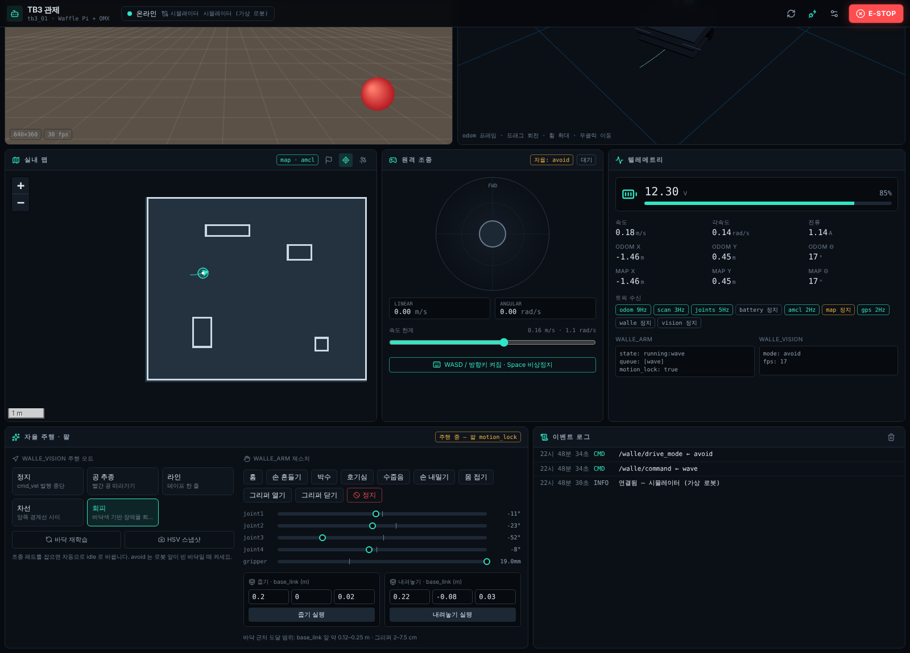

# robot-dashboard — TurtleBot3 관제 대시보드

TurtleBot3(Waffle Pi / Burger) + OpenMANIPULATOR-X + `walle_arm` · `walle_vision` 을
브라우저 하나로 보고 조종하는 Next.js 대시보드입니다.

> **실물 로봇 연결 순서(전원 · bringup · 영상 · 문제 해결)는 [docs/MONITORING.md](docs/MONITORING.md) 를 보세요.**
> **터틀봇 부팅 시 자동 실행은 [docs/AUTOSTART.md](docs/AUTOSTART.md)** — `sudo ./install.sh --download-mediamtx --now` 한 줄로 설치합니다.



| 영역 | 구현 |
|---|---|
| UI | Next.js 16 (App Router, 정적 export) · React 19 · Tailwind CSS 4 · Lucide · zustand |
| 3D | React Three Fiber — 로봇·OMX 팔(`/joint_states`), LaserScan, PointCloud2, 주행 궤적 |
| 지도 | Leaflet — 실내 `OccupancyGrid`(CRS.Simple, Nav2 목표 지정) / 실외 `NavSatFix`(OSM·CARTO, Mapbox 선택) |
| 통신 | rosbridge_suite(WebSocket) **또는** MQTT(Mosquitto/EMQX) **또는** 내장 시뮬레이터 |
| 영상 | WebRTC WHEP(MediaMTX·go2rtc) / MJPEG(web_video_server) |

```
 브라우저 ──ws:9090──▶ rosbridge_server ──┐
    │     └ws:9001──▶ Mosquitto ◀─1883─ ros2_mqtt_bridge.py ──┤── ROS 2 (bringup, walle_arm, walle_vision, Nav2)
    └──WHEP:8889──▶ MediaMTX ◀─RTSP── image_to_rtsp.py ◀── /camera/image_raw (camera_ros)
```

---

## 1. 바로 실행 (로봇 없이)

```bash
npm install
npm run dev            # http://localhost:3000  → 시뮬레이터 모드로 바로 동작
```
시뮬레이터는 6×5 m 방, LDS 레이캐스트, `/cmd_vel` 적분, Nav2 목표 추종, walle_vision 모드(avoid/line/ball),
walle_arm 제스처 키프레임을 흉내 냅니다. 모든 데이터가 실제 ROS 메시지와 같은 JSON 모양이라 UI 코드는 실물과 동일합니다.

배포: `npm run build` → `out/` 폴더(정적 파일)를 NGINX, SBC, 아무 정적 호스팅에 올리면 됩니다.

## 2. rosbridge 로 연결 (권장 시작점)

```bash
# [SBC]
sudo apt install ros-jazzy-rosbridge-suite
ros2 launch rosbridge_server rosbridge_websocket_launch.xml
```
대시보드 ⚙ 설정 → **rosbridge** → `ws://<로봇IP>:9090` → 적용.

- 토픽별 스로틀은 `lib/useConnection.ts` 에서 지정(odom 50 ms, scan 100 ms, map 2 s …).
- PointCloud2 는 설정에서 토픽 이름을 넣으면 켜지고, `cbor` 압축으로 받습니다.
- 대시보드를 **https** 로 열면 브라우저가 `ws://` 를 막습니다(mixed content). LAN 에서는 http 로 열거나,
  rosbridge 앞에 TLS 리버스 프록시(wss)를 두세요.

## 3. MQTT 로 연결 (여러 대·원격망·클라우드)

```bash
# [SBC 또는 서버] 브로커
sudo apt install mosquitto python3-paho-mqtt
sudo cp robot-side/mosquitto.conf /etc/mosquitto/conf.d/robot.conf && sudo systemctl restart mosquitto
# [SBC] 브리지
python3 robot-side/ros2_mqtt_bridge.py --ros-args -p config:=robot-side/bridge.yaml
```
대시보드 설정 → **MQTT** → `ws://<브로커IP>:9001`, prefix `robots`, 로봇 ID `tb3_01`.

토픽 규칙
```
robots/tb3_01/state/odom          로봇 → 웹 (ROS 메시지 JSON)
robots/tb3_01/cmd/cmd_vel         웹 → 로봇 ({"type": ..., "msg": ...})
robots/tb3_01/online              "1" / 끊기면 LWT "0"
```
- 브리지는 `bridge.yaml` 의 **inbound 목록에 있는 토픽만** ROS 로 넘깁니다.
- `cmd_vel` 이 0.5 초 이상 끊기면 브리지가 정지 명령을 대신 보냅니다.
- 로봇을 늘리면 `robot_id` 만 바꿔 같은 브로커에 붙이면 됩니다. EMQX 를 쓰면 `ws://host:8083/mqtt`.

## 4. 저지연 영상 (WebRTC)

**Pi Camera 는 한 프로세스만 열 수 있습니다.** walle_vision 이 `camera_ros` 로 카메라를 쓰고 있으므로,
영상은 ROS 토픽에서 받아 H.264 로 인코딩해 MediaMTX 로 보냅니다.

```bash
# [SBC]
sudo apt install ffmpeg
# MediaMTX arm64 바이너리를 robot-side/ 에 받아 두고
./mediamtx mediamtx.yml
python3 image_to_rtsp.py --ros-args -p image_topic:=/camera/image_raw -p fps:=15
#   Pi 4 하드웨어 인코더: -p encoder:=h264_v4l2m2m
```
대시보드 설정 → 영상 **WebRTC (WHEP)** → `http://<로봇IP>:8889/cam/whep`.

| 구성 | URL | 언제 |
|---|---|---|
| MediaMTX + image_to_rtsp | `http://IP:8889/cam/whep` | walle_vision 과 함께 (기본) |
| go2rtc 직접 캡처 | `http://IP:1984/api/webrtc?src=cam` | 카메라를 영상 전용으로 쓸 때 (`go2rtc.yaml`) |
| web_video_server | `http://IP:8080/stream?topic=/camera/image_raw` (MJPEG 모드) | 가장 간단, 지연·대역폭 큼 |

영상 패널 아래에 해상도·fps·비트레이트·RTT·지터버퍼가 표시됩니다. 같은 LAN 이면 보통 RTT 10 ms 내외,
화면 지연 150–300 ms 정도가 목표입니다. 외부망에서 붙어야 하면 TURN 서버가 필요합니다.

`robot-side/start_robot_side.sh rosbridge|mqtt` 가 위 프로세스를 한 번에 띄우는 예시입니다.

## 5. 화면 구성과 조작

| 패널 | 내용 |
|---|---|
| 헤더 | 연결 상태, 재연결, 설정, **E-STOP** (단축키 `Space`) |
| 카메라 | WHEP/MJPEG, 스냅샷 저장, 전체화면, 조준선 |
| 3D 뷰 | odom 프레임. 로봇 따라가기 / 위에서 보기 / 격자 토글 |
| 실내 맵 | `/map` + `/amcl_pose`(없으면 odom). 🚩 누르고 지도에서 **누른 곳 = 위치, 끌기 = 방향** → `/goal_pose` |
| 실외 GPS | `/fix` 궤적. `NEXT_PUBLIC_MAPBOX_TOKEN` 이 있으면 Mapbox, 없으면 CARTO dark |
| 원격 조종 | 가상 조이스틱 / WASD·방향키, 속도 한계 슬라이더 |
| 자율 주행 · 팔 | `/walle/drive_mode`, `/walle/command`, 관절 바, 줍기·내려놓기 좌표 |
| 텔레메트리 | 배터리(3S 11.0 V 경고), 속도, 포즈, 토픽별 수신 Hz, walle 상태 JSON |

안전 규칙
- 조종은 **누르고 있는 동안만** 10 Hz 로 `cmd_vel` 발행(데드맨). 떼거나 탭 전환·창 포커스를 잃으면 0 을 3번 보내고 중단.
- 조종을 시작하면 walle_vision 을 `idle` 로 돌려 `cmd_vel` 이 두 곳에서 나오지 않게 합니다.
- E-STOP: 정지 5회 + 팔 `stop` + 주행 `idle` + 조종 잠금. 다시 눌러야 풀립니다.
- 브라우저 쪽 안전장치는 보조 수단입니다. walle_vision 의 LiDAR 안전정지, walle_arm 의 motion_lock 이 1차 방어선입니다.

## 6. 설정 메모

- **cmd_vel 타입**: Jazzy 의 bringup 버전에 따라 `Twist`/`TwistStamped` 가 다릅니다.
  `ros2 topic info /cmd_vel -v` 로 구독자 타입을 보고 설정에서 맞추세요 (MQTT 면 `bridge.yaml` 도).
- **경로 B (버거 + U2D2)**: 팔이 `/arm` 네임스페이스 → JointState 토픽을 `/arm/joint_states` 로,
  로봇 모델 Burger, `mount_x/z` 를 walle_arm 실측값과 같게.
- 설정은 브라우저 localStorage 에 저장됩니다. 기본값은 `.env.example` 을 `.env.local` 로 복사해 바꾸세요.

## 7. 구조
```
docs/                MONITORING.md (실물 연결 가이드), AUTOSTART.md (부팅 자동 실행), images/
app/                 layout, page, globals.css (테마 토큰)
components/          Dashboard, Header, SettingsDrawer, VideoPanel, Scene3D, MapPanel,
                     TeleopPanel, CommandPanel, TelemetryPanel, LogPanel, Panel
lib/transport/       types.ts (공통 인터페이스) · rosbridge.ts · mqtt.ts · mock.ts (시뮬레이터)
lib/useConnection.ts 구독 등록 → zustand 스토어
lib/ros.ts           메시지 변환(LaserScan, PointCloud2, 쿼터니언), 명령 발행, 비상정지
lib/gestures.ts      walle_arm 명령·walle_vision 모드 목록, 시뮬레이터 키프레임
robot-side/          ros2_mqtt_bridge.py + bridge.yaml, image_to_rtsp.py, mediamtx.yml, go2rtc.yaml,
                     mosquitto.conf, start_robot_side.sh
                     autostart/ — systemd 자동 실행 (install.sh, tb3ctl, tb3-run.sh, tb3@.service.in)
```
새 통신 방식을 붙이려면 `Transport` 인터페이스(connect / subscribe / publish / onState)만 구현하면 됩니다.

## 8. 다음 단계 아이디어
- `tf2_web_republisher` 로 TF 를 받아 map↔odom 보정, 3D 뷰에 맵 바닥 텍스처 깔기
- Nav2 `NavigateToPose` 액션 피드백(남은 거리·ETA)과 웨이포인트 순찰
- walle_vision 디버그 영상(`/walle/vision/debug`)을 두 번째 영상 스트림으로 추가
- MQTT + 로봇 ID 목록으로 다중 로봇 함대 뷰, 계정·권한(EMQX ACL)
- 모바일 앱(iOS/Android)에서는 같은 MQTT 토픽 규칙과 WHEP URL 을 그대로 재사용 가능
